# คู่มือการใช้งาน GreenLoop Net Zero

GreenLoop Net Zero เป็นเว็บแอปพลิเคชันสำหรับวัดคาร์บอนฟุตพริ้นท์รายปีของคุณ แล้วช่วยลดด้วยการซื้อ-ขายอุปกรณ์ดิจิทัลมือสองและการรีไซเคิลขยะอิเล็กทรอนิกส์ (E-Waste) ทุกกิจกรรมได้ทั้ง Green Point และปริมาณคาร์บอนที่ลดได้

คู่มือนี้แบ่งเป็น 2 ส่วน: [สำหรับสมาชิก](#ส่วนที่-1-สำหรับสมาชิก) และ [สำหรับผู้ดูแลระบบ](#ส่วนที่-2-สำหรับผู้ดูแลระบบ)

**หน่วยที่ใช้ในระบบ:** kgCO₂e คือกิโลกรัมคาร์บอนไดออกไซด์เทียบเท่า ใช้วัดปริมาณก๊าซเรือนกระจกทั้งที่ปล่อยและที่ลดได้

---

## ส่วนที่ 1: สำหรับสมาชิก

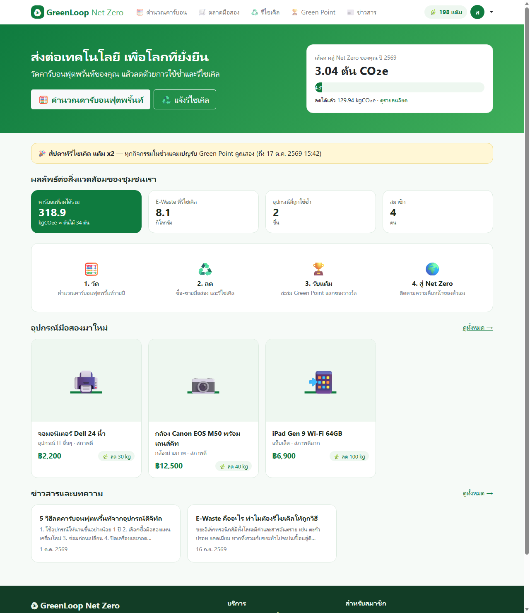

### 1.1 สมัครสมาชิก

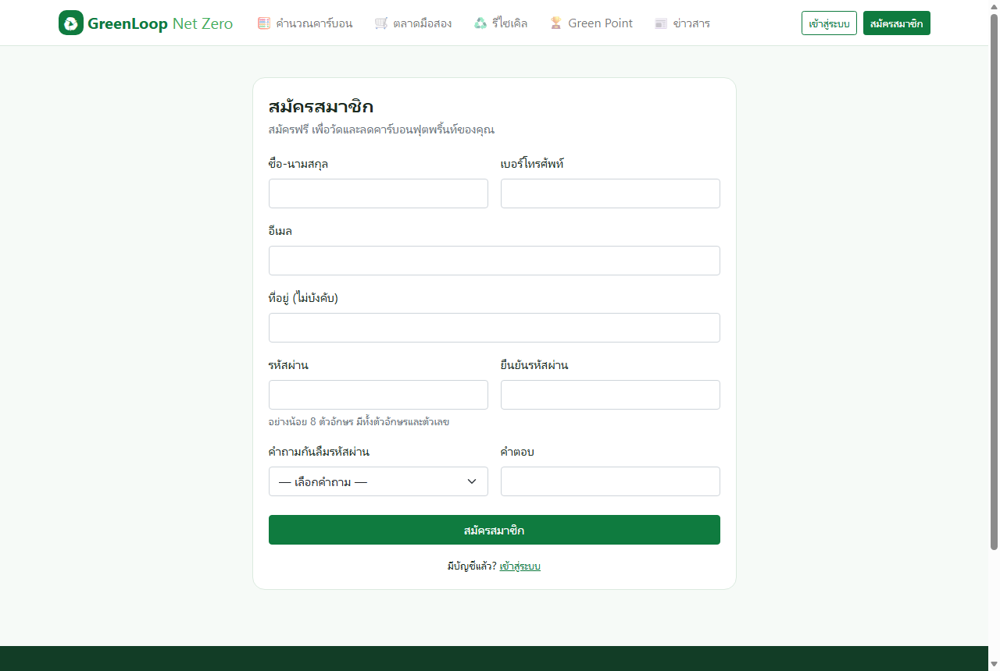

1. กดปุ่ม **สมัครสมาชิก** ที่มุมขวาบน
2. กรอกข้อมูลตามตาราง แล้วกด **สมัครสมาชิก**

| ช่อง | เงื่อนไข |
| --- | --- |
| ชื่อ-นามสกุล | 2-100 ตัวอักษร |
| เบอร์โทรศัพท์ | ตัวเลข 9-10 หลัก ขึ้นต้นด้วย 0 |
| อีเมล | รูปแบบอีเมลถูกต้อง และยังไม่เคยใช้สมัคร |
| ที่อยู่ | ไม่บังคับ |
| รหัสผ่าน | อย่างน้อย 8 ตัวอักษร มีทั้งตัวอักษรภาษาอังกฤษและตัวเลข |
| คำถามกันลืมและคำตอบ | ใช้ตั้งรหัสผ่านใหม่เมื่อลืมรหัสผ่าน ควรจำคำตอบให้ได้ |

เมื่อสมัครสำเร็จ ระบบจะเข้าสู่ระบบให้ทันทีและพาไปที่หน้าคำนวณคาร์บอนฟุตพริ้นท์

### 1.2 เข้าสู่ระบบและออกจากระบบ

- **เข้าสู่ระบบ:** กด **เข้าสู่ระบบ** กรอกอีเมลและรหัสผ่าน
- **ออกจากระบบ:** กดรูปโปรไฟล์ที่มุมขวาบน แล้วเลือก **ออกจากระบบ**
- หากไม่ใช้งานเกิน 30 นาที ระบบจะออกจากระบบให้อัตโนมัติ

### 1.3 ลืมรหัสผ่าน

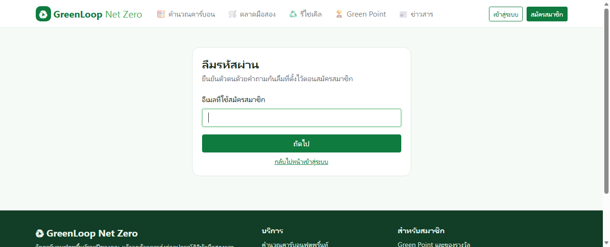

1. ที่หน้าเข้าสู่ระบบ กด **ลืมรหัสผ่าน?**
2. กรอกอีเมลที่ใช้สมัคร แล้วกด **ถัดไป**
3. ตอบคำถามกันลืมที่ตั้งไว้ตอนสมัคร และกรอกรหัสผ่านใหม่ 2 ครั้ง
4. กด **ตั้งรหัสผ่านใหม่** แล้วเข้าสู่ระบบด้วยรหัสผ่านใหม่

ตอบผิดได้ไม่เกิน 5 ครั้ง หากเกินต้องเริ่มใหม่หรือติดต่อผู้ดูแลระบบ

### 1.4 แก้ไขโปรไฟล์และเปลี่ยนรหัสผ่าน

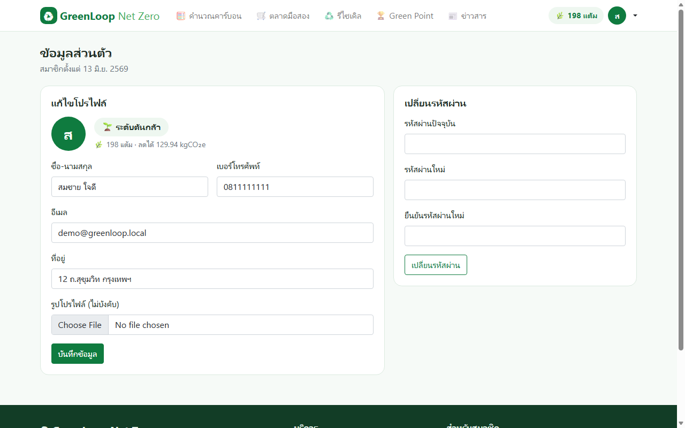

กดรูปโปรไฟล์ แล้วเลือก **ข้อมูลส่วนตัว**

- **แก้ไขโปรไฟล์:** แก้ชื่อ เบอร์โทร อีเมล ที่อยู่ หรืออัปโหลดรูปโปรไฟล์ (JPG, PNG, GIF, WEBP ไม่เกิน 5MB) แล้วกด **บันทึกข้อมูล**
- **เปลี่ยนรหัสผ่าน:** กรอกรหัสผ่านปัจจุบัน และรหัสผ่านใหม่ 2 ครั้ง แล้วกด **เปลี่ยนรหัสผ่าน**

### 1.5 คำนวณคาร์บอนฟุตพริ้นท์รายปี

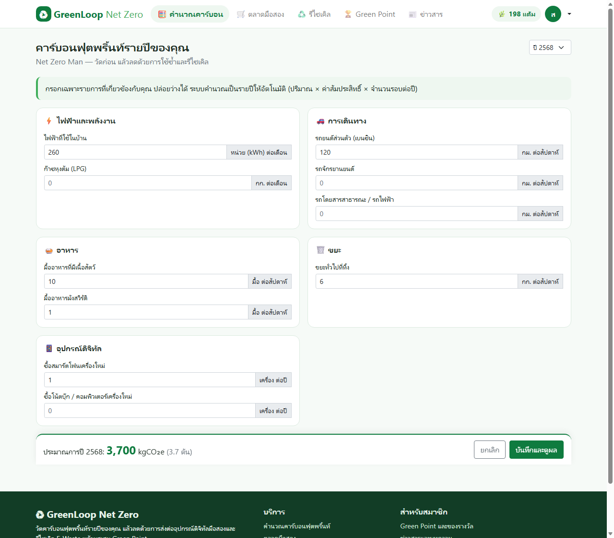

เมนู **คำนวณคาร์บอน**

1. เลือกปีที่ต้องการคำนวณ (ปีปัจจุบันหรือปีก่อนหน้า)
2. กรอกปริมาณในแต่ละหมวด กรอกเฉพาะรายการที่เกี่ยวข้อง ปล่อยว่างได้

| หมวด | ตัวอย่างข้อมูลที่กรอก |
| --- | --- |
| ไฟฟ้าและพลังงาน | หน่วยไฟฟ้าต่อเดือน, ก๊าซหุงต้มต่อเดือน |
| การเดินทาง | ระยะทางต่อสัปดาห์ แยกตามประเภทยานพาหนะ |
| อาหาร | จำนวนมื้อต่อสัปดาห์ |
| ขยะ | น้ำหนักขยะต่อสัปดาห์ |
| อุปกรณ์ดิจิทัล | จำนวนเครื่องที่ซื้อใหม่ต่อปี |

3. ดูยอดประมาณการที่แถบด้านล่าง ซึ่งเปลี่ยนตามที่กรอก
4. กด **บันทึกและดูผล**

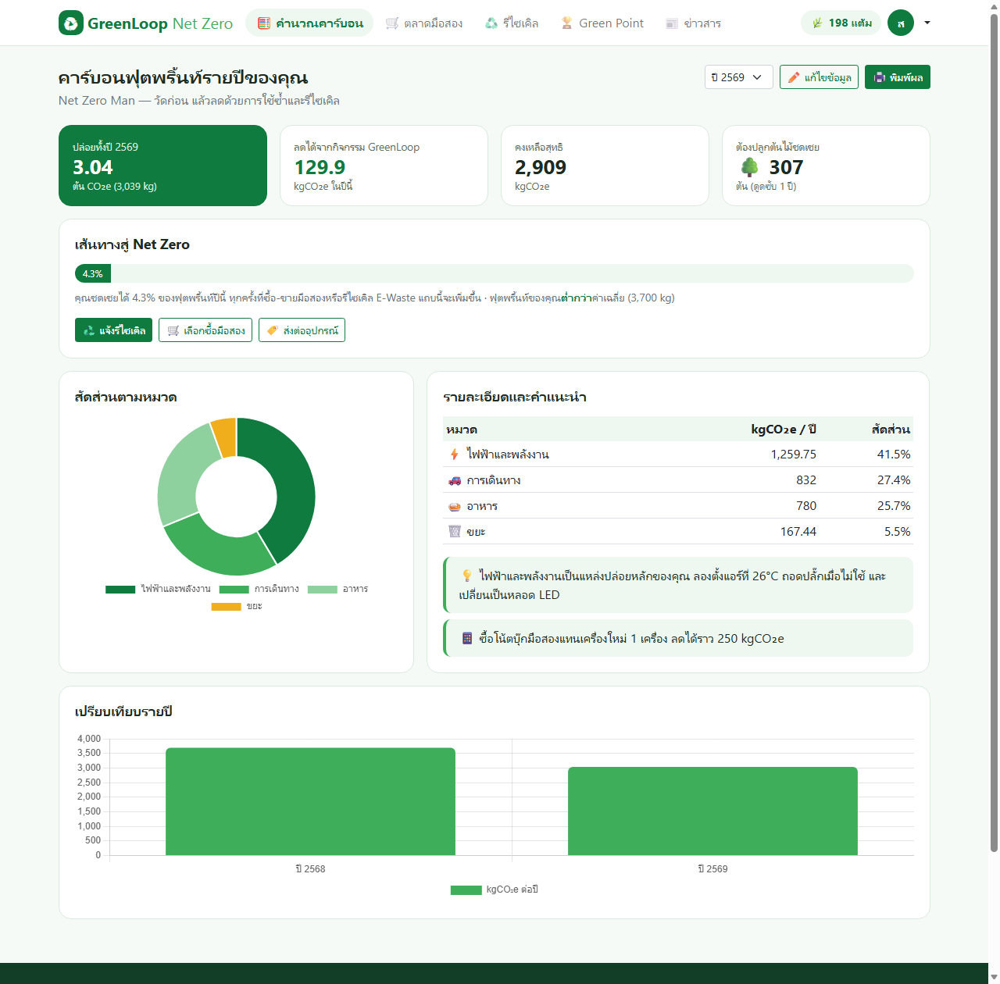

**หน้าผลคำนวณแสดง:**

- ปริมาณที่ปล่อยทั้งปี คาร์บอนที่ลดได้จากกิจกรรมในระบบ คงเหลือสุทธิ และจำนวนต้นไม้ที่ต้องปลูกชดเชย
- แถบ **เส้นทางสู่ Net Zero** บอกว่าชดเชยไปแล้วกี่เปอร์เซ็นต์ของฟุตพริ้นท์ปีนั้น
- กราฟสัดส่วนตามหมวด คำแนะนำตามหมวดที่ปล่อยมากที่สุด และกราฟเปรียบเทียบรายปี (เมื่อมีข้อมูลมากกว่า 1 ปี)

กด **แก้ไขข้อมูล** เพื่อกรอกใหม่ หรือ **พิมพ์ผล** เพื่อพิมพ์หรือบันทึกเป็น PDF

การคำนวณครั้งแรกของแต่ละปีได้รับ Green Point การแก้ไขภายหลังไม่ได้แต้มเพิ่ม

### 1.6 ซื้ออุปกรณ์มือสอง

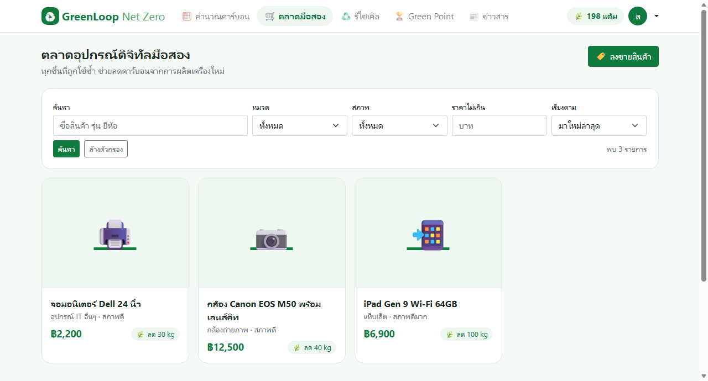

เมนู **ตลาดมือสอง**

1. ค้นหาด้วยชื่อสินค้า หรือกรองตามหมวด สภาพ และราคาสูงสุด
2. เลือกการเรียงลำดับ: มาใหม่ล่าสุด, ราคาต่ำ → สูง, ราคาสูง → ต่ำ หรือลดคาร์บอนมากที่สุด
3. กดที่สินค้าเพื่อดูรายละเอียด และปริมาณคาร์บอนที่ลดได้เมื่อซื้อชิ้นนี้แทนเครื่องใหม่

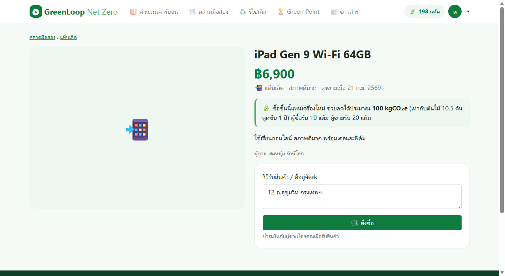

4. ระบุวิธีรับสินค้าหรือที่อยู่จัดส่ง แล้วกด **สั่งซื้อ**
5. ชำระเงินกับผู้ขายโดยตรงเมื่อรับสินค้า
6. เมื่อได้รับสินค้าแล้ว ไปที่ **รายการซื้อ-ขาย** แล้วกด **ได้รับสินค้าแล้ว**

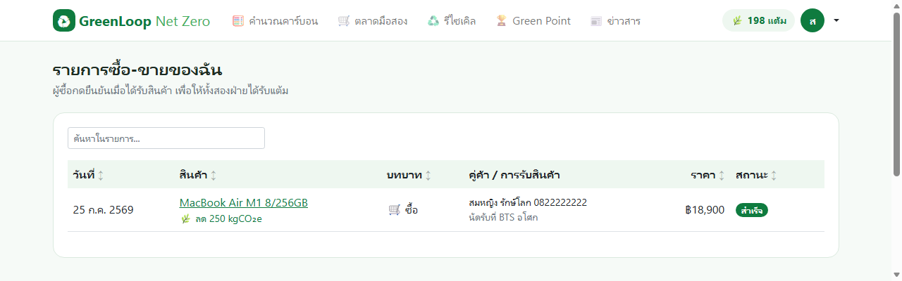

ทั้งผู้ซื้อและผู้ขายจะได้รับ Green Point และคาร์บอนที่ลดได้หลังจากผู้ซื้อกดยืนยันรับสินค้าเท่านั้น

ระหว่างที่สถานะยังเป็น "รอตรวจสอบ" ผู้ซื้อหรือผู้ขายกด **ยกเลิก** ได้ สินค้าจะกลับไปแสดงในตลาด

### 1.7 ลงขายอุปกรณ์มือสอง

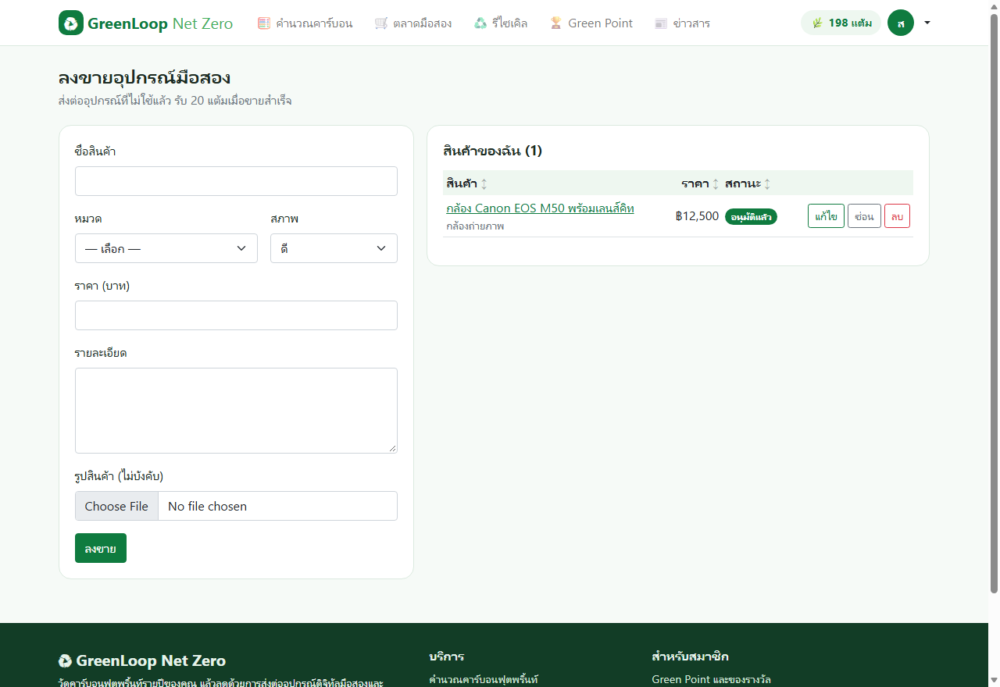

กดรูปโปรไฟล์ แล้วเลือก **ลงขาย / สินค้าของฉัน**

1. กรอกชื่อสินค้า หมวด สภาพ ราคา รายละเอียด และแนบรูป (ไม่บังคับ)
2. กด **ลงขาย**
3. รอผู้ดูแลระบบอนุมัติ สินค้าจึงจะแสดงในตลาด

| สถานะสินค้า | ความหมาย |
| --- | --- |
| รอตรวจสอบ | รอผู้ดูแลระบบอนุมัติ |
| อนุมัติแล้ว | แสดงในตลาด |
| ไม่อนุมัติ | ไม่ผ่านการตรวจสอบ แก้ไขแล้วส่งใหม่ได้ |
| ซ่อน | เจ้าของซ่อนไว้ชั่วคราว |
| ขายแล้ว | มีผู้สั่งซื้อแล้ว |

ในตาราง **สินค้าของฉัน** กด **แก้ไข**, **ซ่อน / แสดง** หรือ **ลบ** ได้ สินค้าที่แก้ไขแล้วต้องรออนุมัติใหม่ และสินค้าที่ขายแล้วแก้ไขหรือลบไม่ได้

### 1.8 แจ้งรีไซเคิล E-Waste

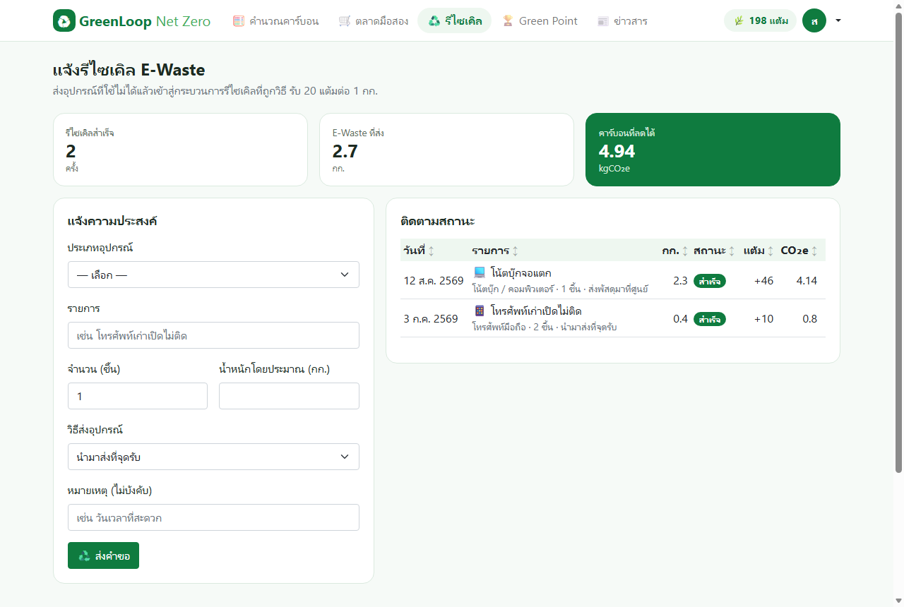

เมนู **รีไซเคิล**

1. เลือกประเภทอุปกรณ์ ระบุรายการ จำนวน และน้ำหนักโดยประมาณ
2. เลือกวิธีส่งอุปกรณ์: นำมาส่งที่จุดรับ, ส่งพัสดุมาที่ศูนย์ หรือนัดรับถึงที่
3. กด **ส่งคำขอ**
4. ติดตามสถานะในตาราง **ติดตามสถานะ** ทางขวา

| สถานะคำขอ | ความหมาย |
| --- | --- |
| รอตรวจสอบ | ส่งคำขอแล้ว รอผู้ดูแลระบบ (ยกเลิกได้ในขั้นนี้) |
| รับคำขอแล้ว | ผู้ดูแลระบบรับเรื่องแล้ว รอตรวจรับอุปกรณ์ |
| สำเร็จ | ตรวจรับแล้ว ได้รับ Green Point และคาร์บอนที่ลดได้ |
| ไม่อนุมัติ | คำขอถูกปฏิเสธหรือถูกยกเลิก |

แต้มและคาร์บอนที่ลดได้คิดจาก**น้ำหนักที่ผู้ดูแลระบบชั่งจริง** ซึ่งอาจต่างจากน้ำหนักที่ประมาณไว้

### 1.9 Green Point และของรางวัล

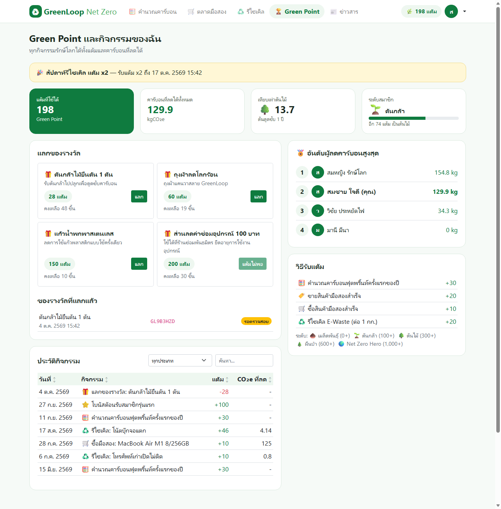

เมนู **Green Point**

**วิธีรับแต้ม** (ค่าเริ่มต้น ผู้ดูแลระบบปรับได้)

| กิจกรรม | แต้ม |
| --- | --- |
| คำนวณคาร์บอนฟุตพริ้นท์ครั้งแรกของปี | +30 |
| ขายสินค้ามือสองสำเร็จ | +20 |
| ซื้อสินค้ามือสองสำเร็จ | +10 |
| รีไซเคิล E-Waste | +20 ต่อ 1 กก. (ขั้นต่ำ 10) |

ในช่วงที่มีแคมเปญแต้มคูณ จะมีแถบสีเหลืองแจ้งที่ด้านบนของหน้า และแต้มที่ได้จะถูกคูณตามที่แคมเปญกำหนด

**ระดับสมาชิก** คิดจากแต้มที่เคยได้รับทั้งหมด การแลกของรางวัลไม่ทำให้ระดับลดลง

| ระดับ | แต้มสะสม |
| --- | --- |
| เมล็ดพันธุ์ | 0 |
| ต้นกล้า | 100 |
| ต้นไม้ | 300 |
| ผืนป่า | 600 |
| Net Zero Hero | 1,000 |

**แลกของรางวัล**

1. ที่หัวข้อ **แลกของรางวัล** กด **แลก** ที่ของรางวัลที่ต้องการ
2. ระบบแสดงรหัสรับของ 8 หลัก และเก็บไว้ในตาราง **ของรางวัลที่แลกแล้ว**
3. แจ้งรหัสนี้กับผู้ดูแลระบบเพื่อรับของ

หน้านี้ยังแสดงอันดับผู้ลดคาร์บอนสูงสุด 5 อันดับ และประวัติกิจกรรมทั้งหมด ซึ่งกรองตามประเภทและค้นหาได้

### 1.10 ข่าวสารและแคมเปญ

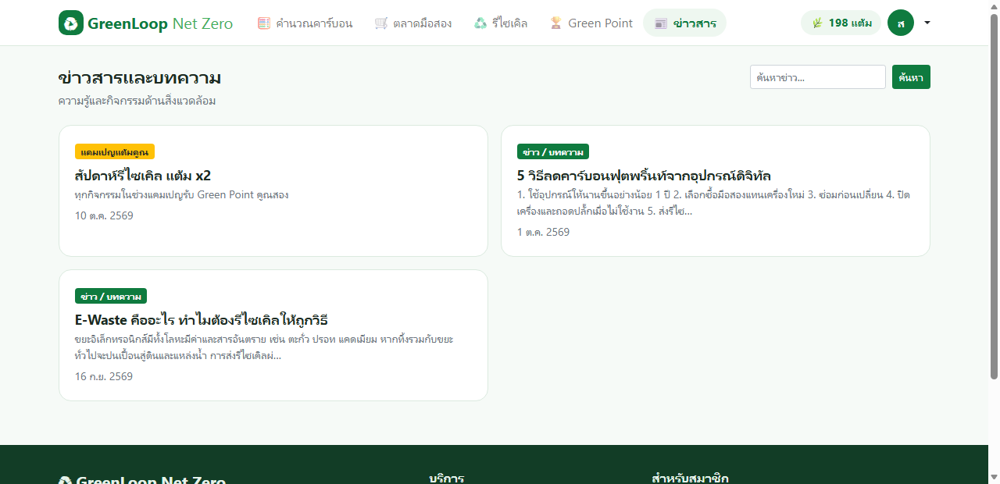

เมนู **ข่าวสาร** แสดงข่าว บทความ และแคมเปญที่อยู่ในช่วงเวลาเผยแพร่ ค้นหาได้จากช่องค้นหามุมขวาบน

### 1.11 แจ้งปัญหา

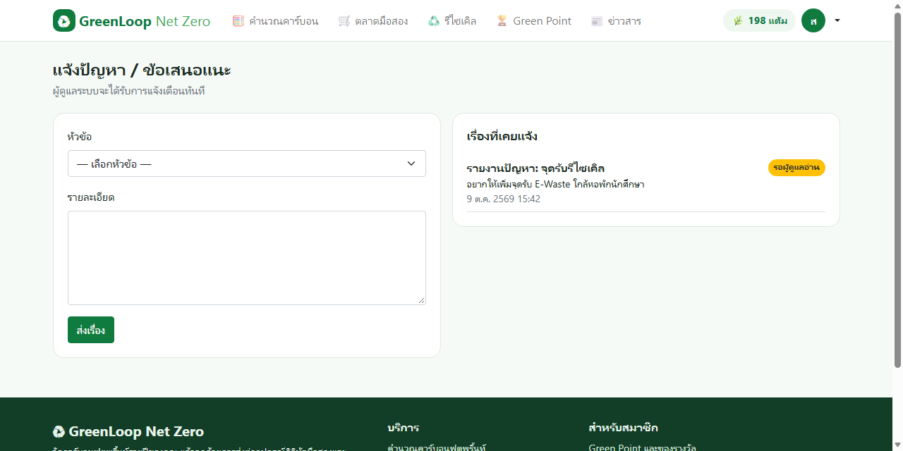

กดรูปโปรไฟล์ แล้วเลือก **แจ้งปัญหา**

1. เลือกหัวข้อ และอธิบายรายละเอียด 10-500 ตัวอักษร
2. กด **ส่งเรื่อง**

เรื่องที่เคยแจ้งแสดงทางขวา พร้อมสถานะ "รอผู้ดูแลอ่าน" หรือ "ผู้ดูแลรับทราบแล้ว"

---

## ส่วนที่ 2: สำหรับผู้ดูแลระบบ

เข้าสู่ระบบด้วยบัญชีผู้ดูแลระบบ ระบบจะพาไปที่หน้าผู้ดูแลทันที หรือกดรูปโปรไฟล์แล้วเลือก **ระบบผู้ดูแล**

ตัวเลขสีเหลืองข้างเมนูคือจำนวนรายการที่รอดำเนินการ

### 2.1 Dashboard

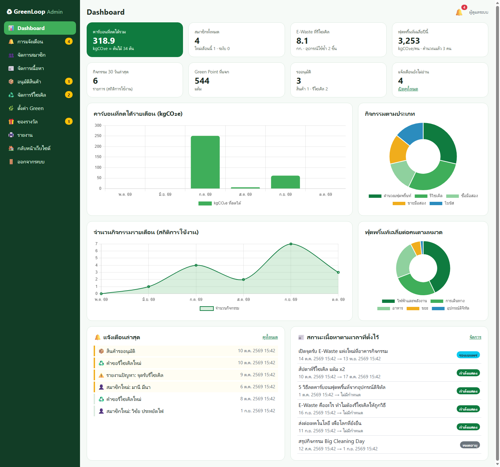

แสดงภาพรวมของระบบ:

- คาร์บอนที่ลดได้รวม จำนวนสมาชิก E-Waste ที่รีไซเคิล ฟุตพริ้นท์เฉลี่ยของปีนี้ จำนวนกิจกรรม 30 วันล่าสุด แต้มที่แจก และรายการที่รออนุมัติ
- กราฟคาร์บอนที่ลดได้รายเดือน กิจกรรมตามประเภท จำนวนกิจกรรมรายเดือน และฟุตพริ้นท์เฉลี่ยตามหมวด
- การแจ้งเตือนล่าสุด และสถานะของเนื้อหาตามเวลาที่ตั้งไว้

### 2.2 การแจ้งเตือน

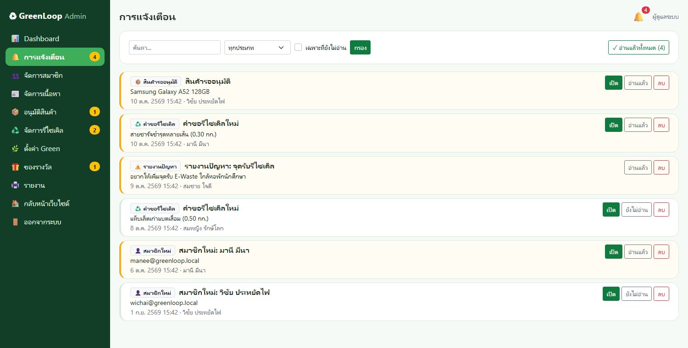

กดรูปกระดิ่งมุมขวาบน หรือเมนู **การแจ้งเตือน** ตัวเลขสีแดงที่กระดิ่งคือจำนวนที่ยังไม่อ่าน

ระบบแจ้งเตือนเมื่อมี: สมาชิกใหม่, สินค้ารออนุมัติ, คำสั่งซื้อ, คำขอรีไซเคิล, การแลกของรางวัล และรายงานปัญหาจากสมาชิก

- **เปิด:** ทำเครื่องหมายอ่านแล้ว และไปยังหน้าที่เกี่ยวข้อง
- **อ่านแล้ว / ยังไม่อ่าน:** สลับสถานะของรายการนั้น
- **อ่านแล้วทั้งหมด:** ทำเครื่องหมายทุกรายการในครั้งเดียว
- กรองตามประเภท เฉพาะที่ยังไม่อ่าน หรือค้นหาด้วยคำค้นได้

### 2.3 จัดการสมาชิก

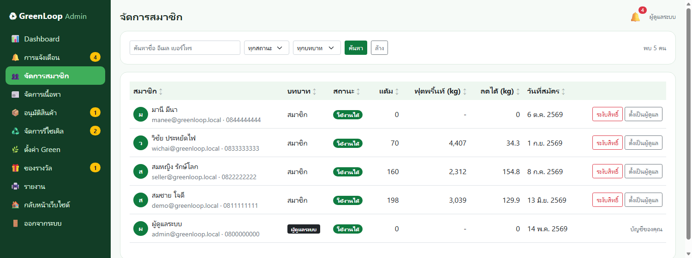

- **ค้นหา** ด้วยชื่อ อีเมล หรือเบอร์โทร และกรองตามสถานะหรือบทบาท
- **ระงับสิทธิ์:** สมาชิกจะถูกออกจากระบบทันทีและเข้าสู่ระบบไม่ได้ กด **ยกเลิกระงับ** เพื่อคืนสิทธิ์
- **ตั้งเป็นผู้ดูแล / ลดเป็นสมาชิก:** เปลี่ยนบทบาทของบัญชี

ผู้ดูแลระบบระงับหรือเปลี่ยนบทบาทบัญชีของตนเองไม่ได้

### 2.4 จัดการเนื้อหาและกำหนดวันเวลาโพสต์

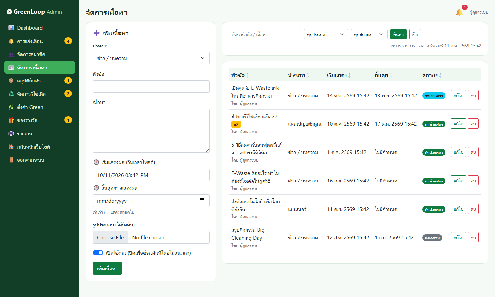

เนื้อหามี 3 ประเภท:

| ประเภท | แสดงที่ |
| --- | --- |
| ข่าว / บทความ | หน้าแรก และหน้าข่าวสาร |
| แบนเนอร์ | ข้อความหลักส่วนบนของหน้าแรก (ใช้รายการล่าสุดที่กำลังแสดง) |
| แคมเปญแต้มคูณ | แถบสีเหลืองในหน้าแรกและหน้า Green Point และคูณแต้มทุกกิจกรรมในช่วงเวลานั้น |

**เพิ่มเนื้อหา**

1. เลือกประเภท กรอกหัวข้อและเนื้อหา
2. ตั้ง **เริ่มแสดงผล (วันเวลาโพสต์)** ตั้งเป็นเวลาในอนาคตได้ เนื้อหาจะปรากฏเองเมื่อถึงเวลา
3. ตั้ง **สิ้นสุดการแสดงผล** หรือเว้นว่างเพื่อแสดงตลอดไป (แคมเปญต้องระบุเสมอ)
4. สำหรับแคมเปญ ระบุตัวคูณ Green Point ระหว่าง 1-5
5. กด **เพิ่มเนื้อหา**

| สถานะเนื้อหา | ความหมาย |
| --- | --- |
| รอเผยแพร่ | ยังไม่ถึงเวลาเริ่มแสดงผล |
| กำลังแสดง | อยู่ในช่วงเวลาแสดงผล |
| หมดอายุ | เลยเวลาสิ้นสุดแล้ว |
| ปิดการแสดง | ปิดสวิตช์ "เปิดใช้งาน" ไว้ ซ่อนทันทีโดยไม่สนเวลา |

สถานะคิดจากเวลาของเครื่องเซิร์ฟเวอร์ ซึ่งแสดงอยู่ที่แถบค้นหาเหนือตาราง

กด **แก้ไข** หรือ **ลบ** ที่ท้ายแต่ละรายการ ค้นหาด้วยหัวข้อหรือเนื้อหา และกรองตามประเภทหรือสถานะได้

### 2.5 อนุมัติสินค้า

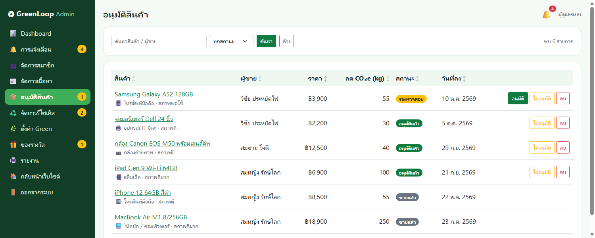

สินค้าที่รออนุมัติอยู่บนสุดของตาราง

- กดชื่อสินค้าเพื่อดูรายละเอียดในแท็บใหม่
- กด **อนุมัติ** เพื่อให้แสดงในตลาด หรือ **ไม่อนุมัติ** เพื่อปฏิเสธ
- กด **ลบ** เพื่อลบสินค้าออกจากระบบ (สินค้าที่ขายแล้วลบไม่ได้)

### 2.6 จัดการรีไซเคิล

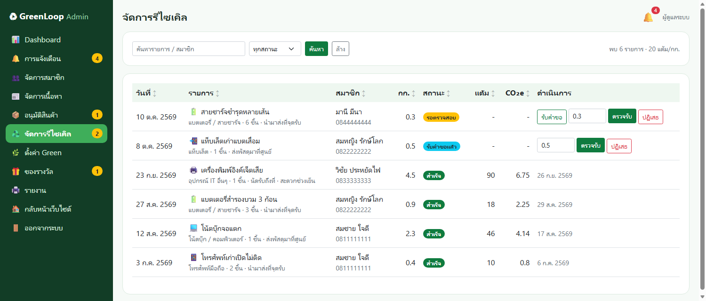

1. กด **รับคำขอ** เมื่อรับเรื่องจากสมาชิก
2. เมื่อได้รับอุปกรณ์ ให้ชั่งน้ำหนักจริง กรอกในช่องตัวเลข แล้วกด **ตรวจรับ**
3. ระบบให้ Green Point และบันทึกคาร์บอนที่ลดได้ให้สมาชิกทันที

กด **ปฏิเสธ** หากคำขอไม่ถูกต้อง คำขอที่ตรวจรับแล้วแก้ไขไม่ได้ จึงควรตรวจน้ำหนักให้ถูกต้องก่อนกดตรวจรับ

### 2.7 ตั้งค่า Green

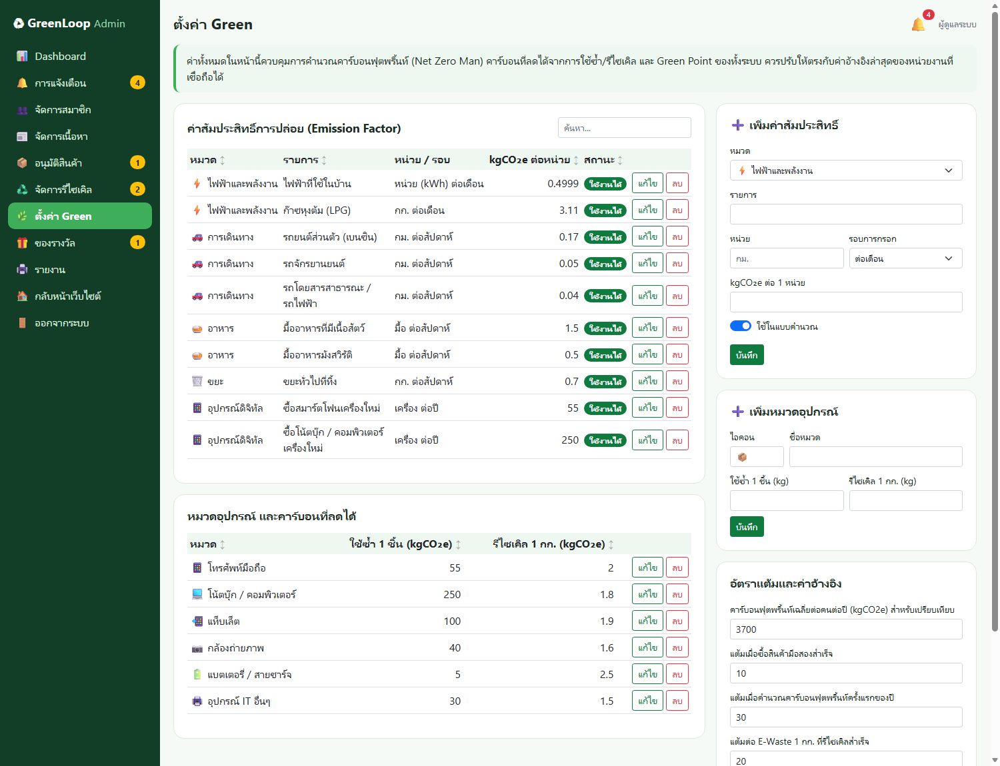

หน้านี้ควบคุมการคำนวณทั้งระบบ มี 3 ส่วน:

| ส่วน | ใช้ทำอะไร |
| --- | --- |
| ค่าสัมประสิทธิ์การปล่อย | รายการในแบบคำนวณคาร์บอนฟุตพริ้นท์: หมวด ชื่อ หน่วย รอบการกรอก (ต่อเดือน / สัปดาห์ / ปี) และ kgCO₂e ต่อ 1 หน่วย |
| หมวดอุปกรณ์ | คาร์บอนที่ลดได้เมื่อใช้ซ้ำ 1 ชิ้น และเมื่อรีไซเคิล 1 กก. |
| อัตราแต้มและค่าอ้างอิง | แต้มของแต่ละกิจกรรม ค่าการดูดซับของต้นไม้ และค่าฟุตพริ้นท์เฉลี่ยที่ใช้เปรียบเทียบ |

ข้อควรทราบ:

- การเปลี่ยนค่ามีผลกับการคำนวณ**ครั้งถัดไป** ผลที่สมาชิกบันทึกไว้แล้วไม่เปลี่ยน
- ค่าสัมประสิทธิ์ที่สมาชิกเคยใช้คำนวณแล้วจะถูกปิดการใช้งานแทนการลบ เพื่อรักษาประวัติ
- หมวดอุปกรณ์ที่มีสินค้าหรือคำขอรีไซเคิลใช้อยู่ลบไม่ได้
- ค่าที่มากับระบบเป็นค่าประมาณสำหรับสาธิต ควรปรับให้ตรงกับค่าอ้างอิงล่าสุดของหน่วยงานที่เชื่อถือได้

### 2.8 ของรางวัล

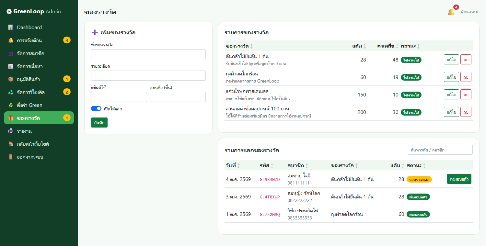

- **เพิ่ม / แก้ไข:** กำหนดชื่อ รายละเอียด แต้มที่ใช้ จำนวนคงเหลือ และสวิตช์ "เปิดให้แลก"
- **ส่งมอบ:** ในตาราง **รายการแลกของรางวัล** ค้นหารหัสที่สมาชิกแจ้ง แล้วกด **ส่งมอบแล้ว**

ของรางวัลที่มีสมาชิกแลกไปแล้วจะถูกปิดการใช้งานแทนการลบ

### 2.9 รายงาน

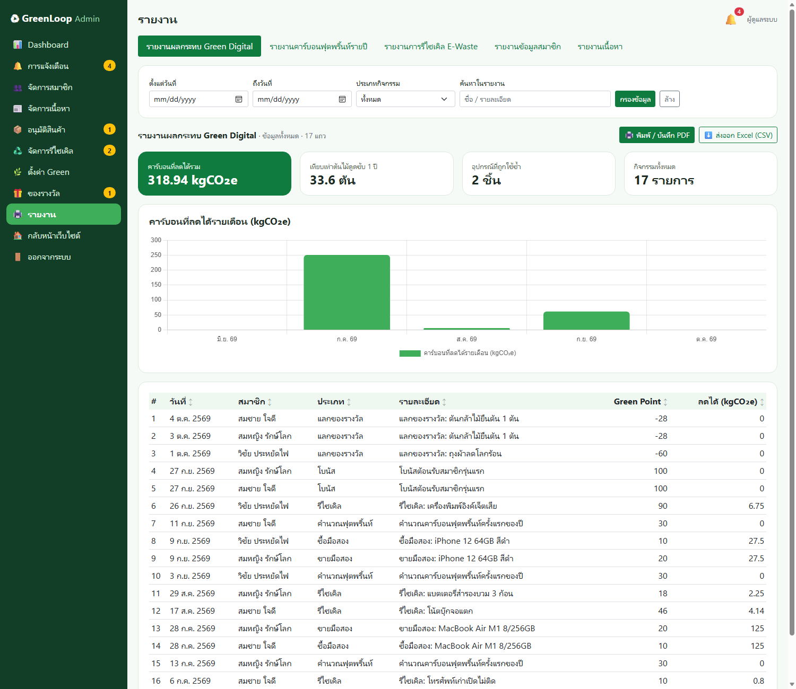

เลือกรายงานจากแถบด้านบน:

| รายงาน | เนื้อหา |
| --- | --- |
| ผลกระทบ Green Digital | ทุกกิจกรรม พร้อมแต้มและคาร์บอนที่ลดได้ สรุปเป็นจำนวนต้นไม้เทียบเท่าและอุปกรณ์ที่ถูกใช้ซ้ำ |
| คาร์บอนฟุตพริ้นท์รายปี | ฟุตพริ้นท์ของสมาชิกแยกตามหมวด คาร์บอนที่ลดได้ในปี คงเหลือสุทธิ และ % สู่ Net Zero |
| การรีไซเคิล E-Waste | คำขอทั้งหมด น้ำหนัก สถานะ แต้ม และคาร์บอนที่ลดได้ |
| ข้อมูลสมาชิก | รายชื่อ สถานะ แต้ม ฟุตพริ้นท์ล่าสุด และวันที่สมัคร |
| เนื้อหา | รายการเนื้อหา ประเภท ช่วงเวลาแสดงผล และสถานะ |

**ขั้นตอน**

1. **กรอง:** เลือกช่วงวันที่ ตัวกรองของรายงานนั้น และพิมพ์คำค้น แล้วกด **กรองข้อมูล** (รายงานคาร์บอนฟุตพริ้นท์กรองตามปีแทนช่วงวันที่)
2. **ดูผล:** ตัวเลขสรุป กราฟ และตารางเปลี่ยนตามเงื่อนไขที่กรอง คลิกหัวคอลัมน์เพื่อเรียงลำดับ
3. **พิมพ์:** กด **พิมพ์ / บันทึก PDF** รายงานจัดหน้าสำหรับกระดาษ A4 พร้อมหัวรายงาน เงื่อนไขที่ใช้ ชื่อผู้พิมพ์ และวันเวลา หากต้องการไฟล์ PDF ให้เลือกเครื่องพิมพ์เป็น "Save as PDF" หรือ "Microsoft Print to PDF"
4. **ส่งออก:** กด **ส่งออก Excel (CSV)** จะได้ไฟล์ `.csv` ที่เปิดด้วย Excel ได้ และภาษาไทยแสดงถูกต้อง

ทั้งการพิมพ์และการส่งออกใช้ข้อมูลตามเงื่อนไขที่กรองอยู่ในขณะนั้น

---

## ปัญหาที่พบบ่อย

| อาการ | สาเหตุและวิธีแก้ |
| --- | --- |
| เข้าสู่ระบบไม่ได้ ขึ้นว่า "บัญชีนี้ถูกระงับสิทธิ์" | ผู้ดูแลระบบระงับบัญชีไว้ ติดต่อผู้ดูแลระบบ |
| ถูกพากลับไปหน้าเข้าสู่ระบบระหว่างใช้งาน | ไม่ได้ใช้งานเกิน 30 นาที เข้าสู่ระบบใหม่ได้เลย |
| ขึ้นว่า "คำขอไม่ถูกต้อง หรือไฟล์ที่อัปโหลดมีขนาดใหญ่เกินไป" | เปิดหน้าค้างไว้นานหรือไฟล์ใหญ่เกิน 5MB โหลดหน้าใหม่แล้วลองอีกครั้ง |
| ลงขายแล้วไม่เห็นสินค้าในตลาด | สินค้ายังอยู่ในสถานะ "รอตรวจสอบ" ต้องรอผู้ดูแลระบบอนุมัติ |
| ซื้อสินค้าแล้วยังไม่ได้แต้ม | ผู้ซื้อยังไม่ได้กด "ได้รับสินค้าแล้ว" ในหน้ารายการซื้อ-ขาย |
| ส่งคำขอรีไซเคิลแล้วยังไม่ได้แต้ม | ได้แต้มเมื่อผู้ดูแลระบบตรวจรับอุปกรณ์และสถานะเป็น "สำเร็จ" |
| ตั้งเวลาโพสต์แล้วเนื้อหาไม่ขึ้นตามเวลา | ตรวจเวลาของเครื่องเซิร์ฟเวอร์ในหน้าจัดการเนื้อหา และตรวจว่าสวิตช์ "เปิดใช้งาน" เปิดอยู่ |
| แถบสู่ Net Zero ไม่ขยับ | แถบนับเฉพาะคาร์บอนที่ลดได้ในปีเดียวกับฟุตพริ้นท์ที่เลือกดู |
